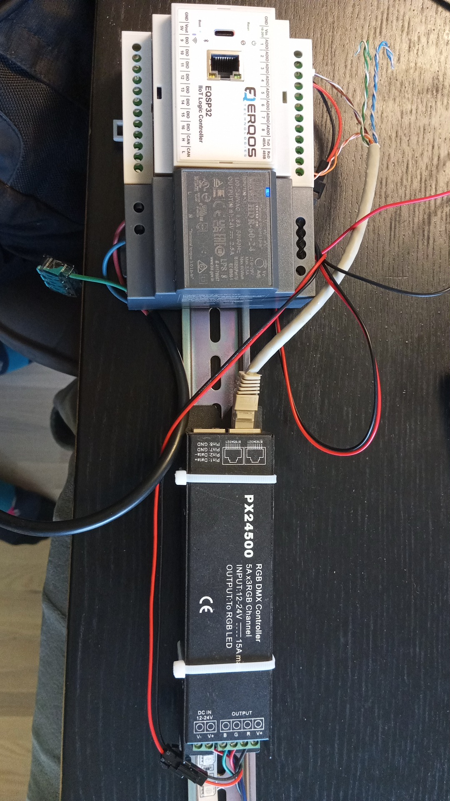

# DMX Scene Box

A small, rugged DMX512 scene controller for architectural lighting. Scenes are plain text files on the device. Dry-contact inputs fire them. An AI (or you, with curl) writes them over a tiny HTTP API.

**The idea:** keep the hardware dumb and the files human-readable, so the clever part can change over the years while the box keeps doing one job.

- Static scene = a list of channel values, with an optional fade and a beep.
- Dynamic scene = a 20-line Lua script the box ticks every 20 ms.
- Triggers = a text file mapping inputs to scenes.
- The device carries its own manual (`description.yaml`) so any AI can read it and program it.
- Nothing listens on the network unless a physical switch says so.

## Hardware


| Part | Notes |
| --- | --- |
| [Erqos EQSP32CE](https://erqos.com/product/eqsp32ce/) | ESP32-S3 DIN-rail controller, Ethernet, RS485, 16 inputs 24 V tolerant, buzzer. About 155 EUR. |
| 24 V DC supply | 7 to 26 V works. Use the same supply for the inputs. |
| DMX fixtures or decoders | Any DMX512 device. Put a 120 ohm terminator at the end of the line. |
| Push buttons / dry contacts | Switch 24 V from the same supply onto the inputs. |

Product photo: Erqos Technologies.

### Wiring

| EQSP32 terminal | Connect to |
| --- | --- |
| GND, VIn | 24 V supply |
| TxD / 485A | DMX Data+ |
| RxD / 485B | DMX Data- |
| GND | DMX ground / shield |
| Inputs 1 to 14 | trigger contacts, 24 V when pressed |
| Input 15 | manual override button (all channels full) |
| Input 16 | setup-mode key switch (held high = setup mode) |
| Ethernet | your LAN |
| USB-C | laptop, for flashing only |

Inputs must never see more than VIn. Feed them from the same supply.



## Flashing

The vendor library is a precompiled binary, so the versions below are fixed.

1. Install [Arduino IDE 2](https://www.arduino.cc/en/software) or [arduino-cli](https://arduino.github.io/arduino-cli/).
2. Boards Manager: add `https://espressif.github.io/arduino-esp32/package_esp32_index.json`, install **esp32 by Espressif 2.0.17** (not 3.x).
3. Library Manager: install **EQSP32 1.5.2** and **RadioLib 7.7.1**.
4. Board: **ESP32S3 Dev Module**, Flash size **8MB**, Partition scheme **8M with spiffs**.
5. Unplug the 24 V from VIn, plug in USB-C, open `firmware/dmx_scene_box/dmx_scene_box.ino`, upload.
6. Reconnect the 24 V.

With arduino-cli:

```
arduino-cli core install esp32:esp32@2.0.17
arduino-cli lib install EQSP32@1.5.2 RadioLib@7.7.1
arduino-cli compile --fqbn esp32:esp32:esp32s3:FlashSize=8M,PartitionScheme=default_8MB firmware/dmx_scene_box
arduino-cli upload  --fqbn esp32:esp32:esp32s3:FlashSize=8M,PartitionScheme=default_8MB -p COM13 firmware/dmx_scene_box
```

Not sure about the wiring? Flash `examples/hardware_check` first. It cycles colours on channels 1 to 3 and reacts to inputs 9 to 12, with no network and no files.

## Network

Plug in Ethernet. The box takes a DHCP address. Read it from the serial monitor at 115200 baud, or from your router. Give it a fixed lease.

Wi-Fi is optional: copy `wifi_secrets.example.h` to `wifi_secrets.h` in the sketch folder, fill it in, flash again. Ethernet wins when both are connected.

## Using it

**1. Setup mode.** Put 24 V on input 16. The web server starts and the box plays `editing.scene`. Open `http://<box-ip>/` in a browser for the file list.

**2. Read the manual off the device.**

```
curl http://<box-ip>/api/files/description.yaml
```

**3. Write a scene.** One statement per line.

```
# foyer-warm.scene
fade 800
beep 880 80
1-3 255
4 120
10-15 40
```

Upload it (the header matters):

```
curl -X PUT -H "Content-Type: text/plain" --data-binary @foyer-warm.scene http://<box-ip>/api/files/foyer-warm.scene
curl -X POST http://<box-ip>/api/play/foyer-warm
```

**4. Make it move.** A file whose first line starts with `--` is a Lua script. The box calls `update(t)` every 20 ms with the elapsed milliseconds. Never sleep, never count ticks, compute from `t`.

```lua
-- breathe.scene: slow blue pulse, 4 s per cycle
function update(t)
  local p = (1 - math.cos(2 * math.pi * (t % 4000) / 4000)) / 2
  dmx.set(3, 30 + 225 * p)
end
```

Vocabulary: `dmx.set(ch, v)`, `dmx.fill(lo, hi, v)`, `dmx.get(ch)`, `dmx.beep(hz, ms)`, `log(...)`, plus Lua `math`, `string`, `table`. Limits: 64 kB heap, 400k instructions per tick. A script error freezes the last frame; it never blacks out the room.

**5. Map the inputs.** `triggers.txt`, one line per input:

```
1 foyer-warm
2 breathe
3 off
```

**6. Leave setup mode.** Drop input 16. The server closes. The box now only drives DMX and watches the inputs. It remembers the last scene across power cuts. If `boot.scene` exists it is played at power-up instead.

### API

| Method | Path | Does |
| --- | --- | --- |
| GET | `/api/status` | mode, scene, script state, IP, uptime |
| GET | `/api/files` | list files |
| GET | `/api/files/{name}` | download |
| PUT | `/api/files/{name}` | upload (body = file, `Content-Type: text/plain`) |
| DELETE | `/api/files/{name}` | delete |
| POST | `/api/play/{name}` | play a scene now |
| GET | `/api/probe?ch=5&to=8&v=255` | light channels 5 to 8, zero the rest. For finding out what is wired where. |

Uploading `editing.scene` applies it live. Uploading `triggers.txt` reloads the map. Scene files are validated before they are stored.

### Let an AI do it

Give your AI assistant a tool that can run `curl` or Python on the same LAN, then:

```
There is a DMX controller on my network at http://<box-ip> and it is in setup mode.
First download http://<box-ip>/api/files/description.yaml and read it.
Then make a scene called "evening" that fades the room to warm white over 2 seconds, upload it and play it.
```

That is the whole point. The device explains itself.

### Backup and restore

```
python tools/dmxbox.py <box-ip> pull backup/      # all files to a folder
python tools/dmxbox.py <box-ip> push backup/      # and back, or onto a spare box
python tools/dmxbox.py <box-ip> play evening
python tools/dmxbox.py <box-ip> probe 1 64
```

## How it is built

- DMX runs in its own FreeRTOS task at 40 Hz with linear crossfades. The web server cannot disturb it.
- Lua 5.4.7 is vendored in `src/lua`, without the io, os, package and debug libraries, with a bounded allocator and an instruction hook.
- Files live in LittleFS, 1.5 MB.
- Inputs are edge-triggered, latest wins. A stuck-high input fires once and then does nothing.
- Port 80 is closed in normal mode. There is no login; the key switch is the lock.

## Licence

MIT. Lua is Copyright (C) 1994-2024 Lua.org, PUC-Rio, MIT licence, see `firmware/dmx_scene_box/src/lua/LICENSE-lua.txt`. The EQSP32 library and product photo belong to Erqos Technologies.
